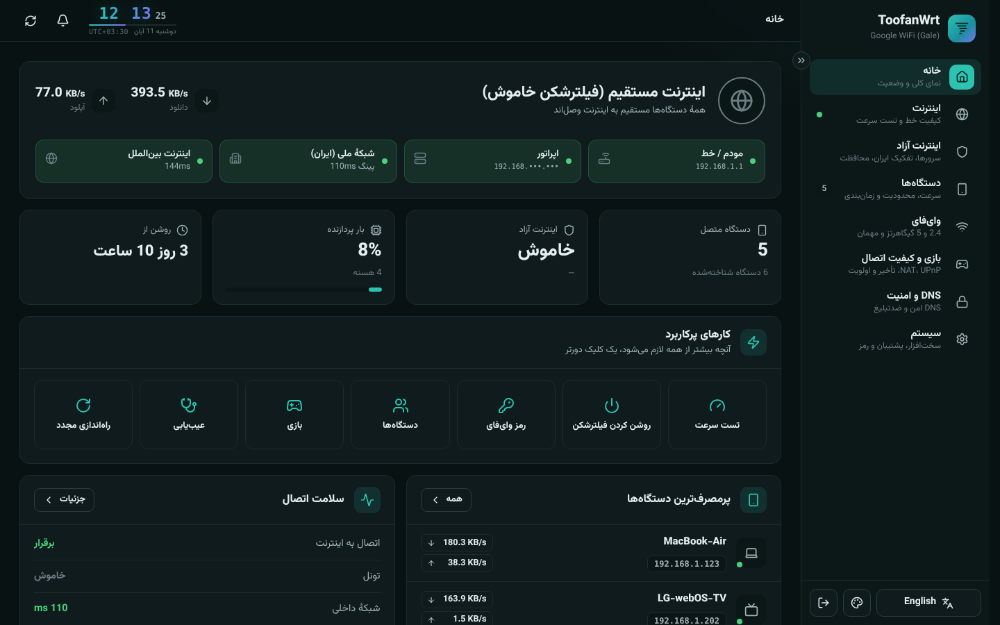
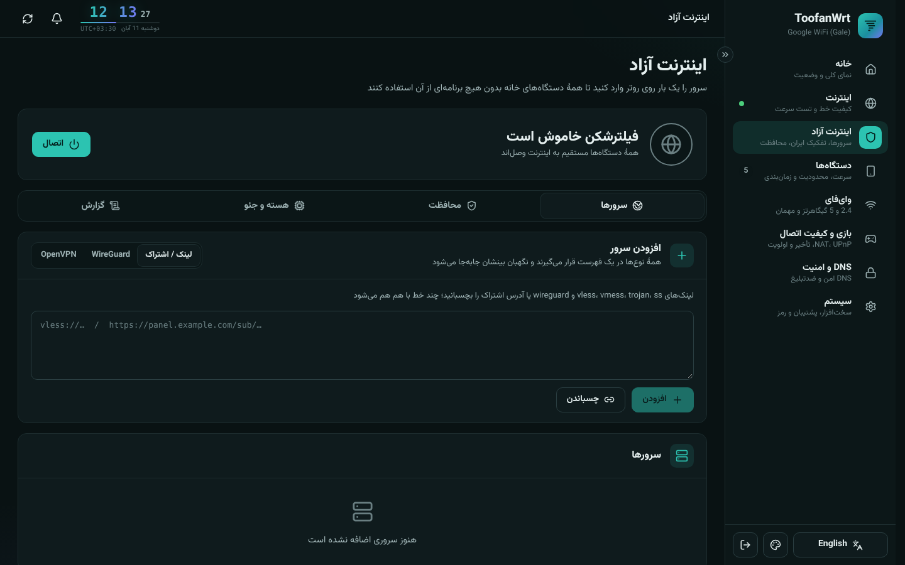
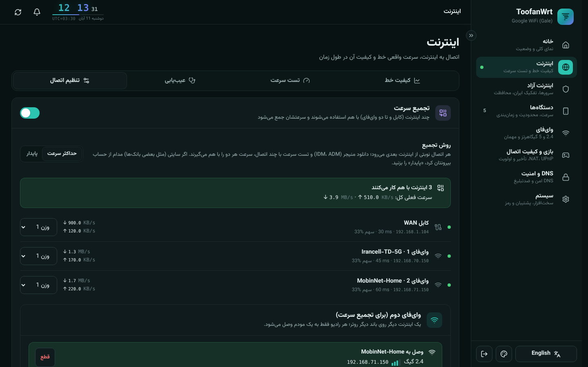
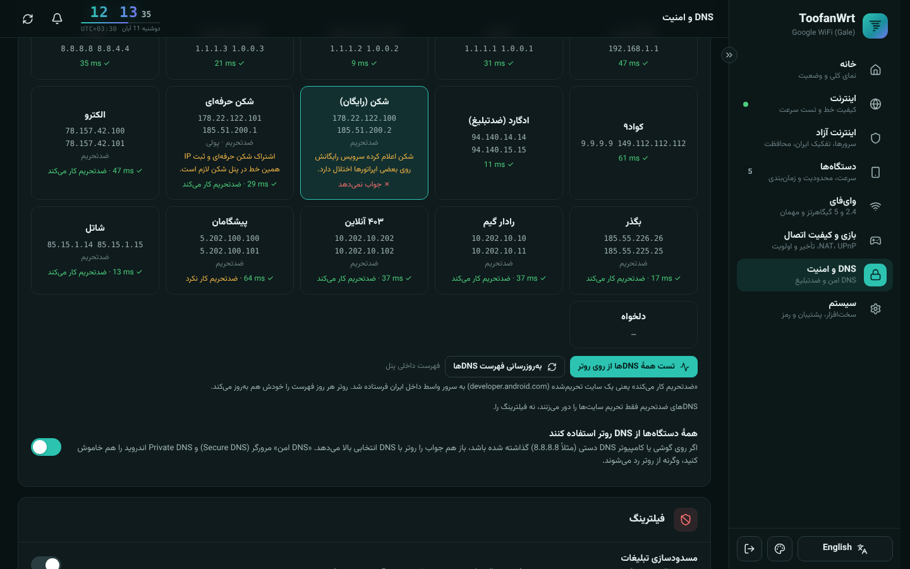
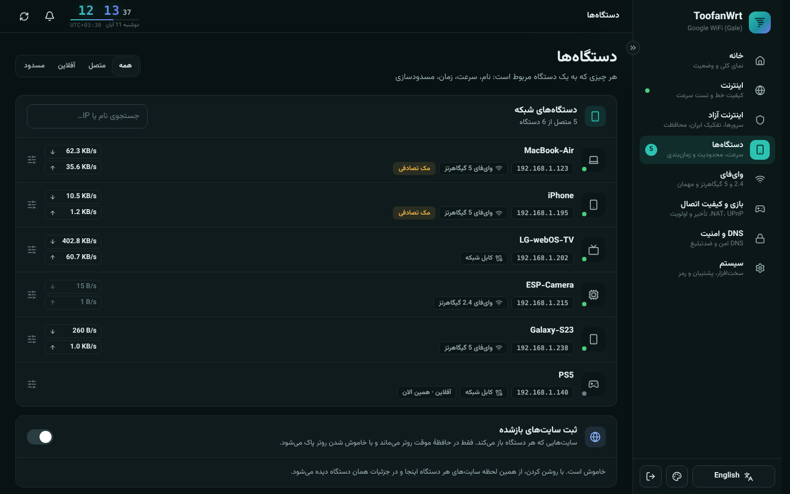
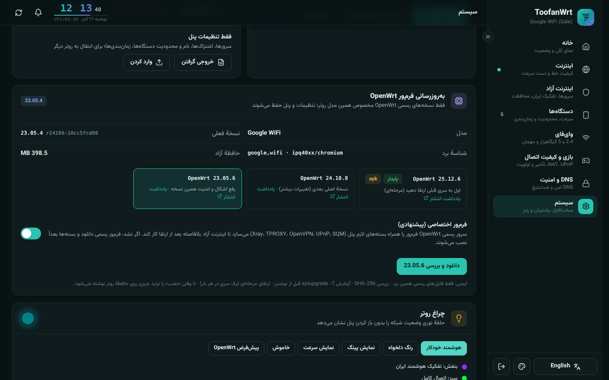
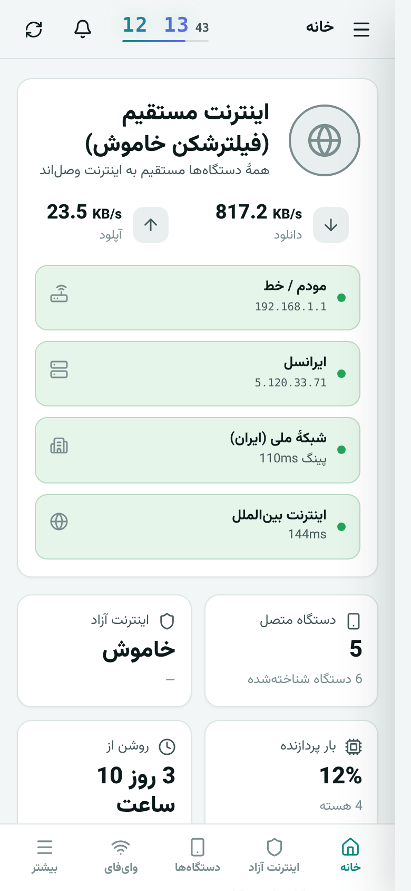

<div align="center">

# 🌪️ ToofanWrt · توفان

**پنل مدیریت روتر OpenWrt، با اینترنت آزاد روی خود روتر، به زبان فارسی**

یک بار روی روتر تنظیم کنید؛ همهٔ دستگاه‌های خانه (گوشی، لپ‌تاپ، تلویزیون، کنسول) بدون نصب هیچ برنامه‌ای از آن استفاده می‌کنند.


[📥 دانلود آخرین نسخه](https://github.com/AmiRAliw24/Toofan-WRT/releases/latest) · [🛠️ نصب](#-نصب) · [📝 تغییرات نسخهٔ ۲](CHANGELOG.md)



</div>

---

## ✨ امکانات

### 🛡️ اینترنت آزاد (Xray)
- 🔗 پشتیبانی از **VLESS، VMess، Trojan، Shadowsocks، WireGuard و OpenVPN** با ترنسپورت‌های raw، ws، grpc، xhttp، httpupgrade و kcp و امنیت TLS یا Reality
- 📋 افزودن با لینک یا **اشتراک (Subscription)** با به‌روزرسانی خودکار
- ⚡ تست هم‌زمان همهٔ سرورها با ترافیک واقعی و **سوییچ خودکار به سریع‌ترین سرور**
- 🩺 نگهبان اتصال با زمان قابل تنظیم (یا خاموش)، وصل دوبارهٔ خودکار و حالت امن
- 🧩 انتخاب نسخهٔ **هستهٔ Xray** (مثل x-ui) با بررسی امضا و برگشت خودکار
- 🌍 **فایل‌های جئو** از منبع معتبر [Iran-v2ray-rules](https://github.com/chocolate4u/Iran-v2ray-rules) با به‌روزرسانی یک‌کلیکی یا خودکار

### 🇮🇷 تفکیک ترافیک ایران
- 🚀 سایت‌های ایرانی **مستقیم**، بقیه از تونل؛ بیش از ۲۰۰۰ محدودهٔ IP ایران داخل خود کرنل (بدون فشار به CPU)
- 🚫 حالت مسدودسازی سایت‌های ایرانی از طریق تونل
- 🔒 **قطع اضطراری (Kill Switch)** و بستن IPv6 برای جلوگیری از نشت

### 🔗 تجمیع سرعت (جدید در نسخهٔ ۲)
- 📶 کابل WAN **به‌علاوهٔ تا دو وای‌فای** (یکی روی هر باند) با هم
- ⚡ حالت **حداکثر سرعت**: دو اینترنت ۲۰ مگ با دانلود منیجر حدود **۴۰ مگ**
- 🏦 حالت **پایدار** برای سایت‌هایی که ورود را به IP گره می‌زنند
- ❤️ آزمایش هر اینترنت هر ۱۰ ثانیه؛ اینترنت قطع‌شده کنار می‌رود و بعد از برگشت خودکار اضافه می‌شود
- ⚖️ وزن‌دهی ۱ تا ۱۰ برای هر اینترنت

### 🌐 DNS و امنیت
- 🧠 **DNS هوشمند**: سایت‌های ایرانی با DNS داخلی (شکن، الکترو، بگذر، ۴۰۳، رادار، پیشگامان، شاتل…) و بقیه رمزنگاری‌شده (DoH) از داخل تونل
- 🧪 **تست زندهٔ همهٔ DNSها از روی روتر**: سرعت پاسخ و کار کردن ضدتحریم
- 🔄 فهرست DNSها **هر روز خودکار به‌روز** می‌شود
- 📱 اجبار همهٔ دستگاه‌ها به DNS روتر (حتی اگر DNS دستی گذاشته باشند)
- 🚯 مسدودسازی تبلیغات، بدافزار و فیشینگ
- 🔐 قفل پنل و SSH از سمت اینترنت

### 📱 دستگاه‌ها
- 📊 سرعت لحظه‌ای و مصرف هر دستگاه، با شناسایی سازنده
- ✏️ نام‌گذاری، مسدودسازی، سقف سرعت، **زمان‌بندی** (مثلاً شب‌ها برای بچه‌ها)
- 🎯 مستقیم بدون فیلترشکن (مثل تلویزیون)، اولویت ترافیک
- 🗂️ فهرست سایت‌های بازشدهٔ هر دستگاه (اختیاری، فقط در حافظهٔ موقت)

### 📡 وای‌فای
- 📻 ۲٫۴ و ۵ گیگاهرتز، WPA2/WPA3، شبکهٔ مهمان ایزوله، کد QR
- 🎚️ کانال، پهنای باند، توان ارسال و کشور، با **بررسی کانال واقعی** بعد از هر تغییر
- 🧭 انتخاب هوشمند خلوت‌ترین کانال
- 🛰️ اتصال روتر به وای‌فای مودم دیگر (حالت تکرارکننده)

### 🎮 بازی و کیفیت اتصال
- 🕹️ نوع NAT، UPnP، تست Bufferbloat، **SQM (cake)** و اولویت دستگاه بازی
- 📈 نمودار تأخیر داخلی و خارجی ۲۴ ساعته و هفتگی
- 🏁 تست سرعت از خود روتر (با پرچم کشور سرورها)
- 🩻 **عیب‌یابی لایه‌به‌لایه** با دکمهٔ **«رفع»** برای هر مشکل (اگر نتواند، علتش را می‌گوید)

### ⚙️ سیستم
- 💾 پشتیبان‌گیری و بازگردانی کامل، خروجی و ورود تنظیمات پنل
- ⬆️ به‌روزرسانی پنل از داخل خودش با **برگشت خودکار** اگر نسخهٔ جدید بالا نیاید
- 🧱 **ارتقای فرم‌ور OpenWrt** مخصوص همین مدل روتر، با بررسی SHA-256 و تست قبل از نوشتن، بدون از دست رفتن تنظیمات
- 💡 کنترل حلقهٔ نوری LED گوگل وای‌فای (حتی رنگ بر اساس سرعت)
- 🌡️ دما، حافظه، پردازنده و ساعت روتر

### 🎨 رابط کاربری
- 🇮🇷 فارسی و 🇬🇧 انگلیسی کامل
- 🌗 تم روشن، تیره و هکری
- 📲 کاملاً واکنش‌گرا روی موبایل، تبلت و دسکتاپ، بدون پرش صفحه

---

## 🖼️ تصاویر

<table>
<tr>
<td><p align="center">🛡️ اینترنت آزاد</p></td>
<td><p align="center">🔗 تجمیع سرعت</p></td>
</tr>
<tr>
<td><p align="center">🌐 DNS با تست زنده</p></td>
<td><p align="center">📱 دستگاه‌ها</p></td>
</tr>
<tr>
<td><p align="center">🧱 ارتقای فرم‌ور OpenWrt</p></td>
<td align="center"><p align="center">📲 نمای موبایل</p></td>
</tr>
</table>

---

## 📦 نصب

> 🧰 **پیش‌نیاز:** روتر با **OpenWrt 23.05 یا 24.10** (هدف اصلی: Google WiFi AC-1304) و دسترسی SSH.

**۱. دانلود:** فایل `toofanwrt-2.0.0.tar.gz` را از [صفحهٔ انتشار](https://github.com/AmiRAliw24/Toofan-WRT/releases/latest) بگیرید.

**۲. ارسال به روتر** (در PowerShell ویندوز):
```powershell
scp -O "$env:USERPROFILE\Downloads\toofanwrt-2.0.0.tar.gz" root@192.168.1.1:/tmp/
```

**۳. نصب** (با SSH روی روتر):
```sh
ssh root@192.168.1.1
cd /tmp && rm -rf /tmp/toofanwrt && tar xzf toofanwrt-2.0.0.tar.gz && sh toofanwrt/install.sh
```

**۴. ورود:** آدرس `http://192.168.1.1` را باز کنید. 🔑 رمز ورود همان رمز root روتر (SSH) است.

### 🔁 به‌روزرسانی‌های بعدی
از **سیستم ← به‌روزرسانی پنل ← بررسی**، نسخهٔ جدید مستقیم از همین صفحه نصب می‌شود. راه دیگر «نصب از فایل» است. اگر نسخهٔ جدید درست بالا نیاید، نسخهٔ قبلی خودکار برمی‌گردد. ✅

### 💡 نکته‌ها
- 🏠 ToofanWrt **رابط اصلی روتر** روی پورت ۸۰ است. LuCI حذف می‌شود؛ اگر بعداً نصب شود، خودکار روی پورت **8081** می‌رود. (`KEEP_LUCI=1 sh install.sh` نگهش می‌دارد.)
- 📴 اگر روتر به سرور بسته‌های OpenWrt دسترسی نداشته باشد، پنل باز هم نصب می‌شود و بسته‌ها را بعداً خودش نصب می‌کند.
- 🗑️ **حذف:** `sh /usr/share/toofanwrt-uninstall.sh`

---

## 🧑‍💻 ساخت از سورس

نیاز: **Go 1.22+** و **Node 18+**

```sh
./build.sh                      # dist/toofanwrt-<version>.tar.gz
```

اجرای آزمایشی روی کامپیوتر، بدون روتر و با داده‌های نمایشی (رمز `admin`):
```sh
cd frontend && npm ci && npx vite build && cd ../backend
go run . -mock -listen 127.0.0.1:8080
```

```
backend/    Go: API، Xray، nftables، dnsmasq، UCI، تجمیع سرعت، فرم‌ور
frontend/   Preact + Vite: رابط کاربری
openwrt/    نصب، حذف، init و hotplug
```

---

## 🙏 قدردانی
- 🌍 [Iran-v2ray-rules](https://github.com/chocolate4u/Iran-v2ray-rules) برای فایل‌های جئو
- 🚀 [Xray-core](https://github.com/XTLS/Xray-core)
- 🏳️ فونت پرچم‌ها: [Twemoji Country Flags](https://github.com/talkjs/country-flag-emoji-polyfill) (MIT)، طرح‌ها از [Twemoji](https://github.com/twitter/twemoji) (CC-BY 4.0)
- 🔤 فونت فارسی: Vazirmatn (OFL)

<div align="center">

ساخته‌شده با ❤️ برای اینترنت آزاد

</div>
